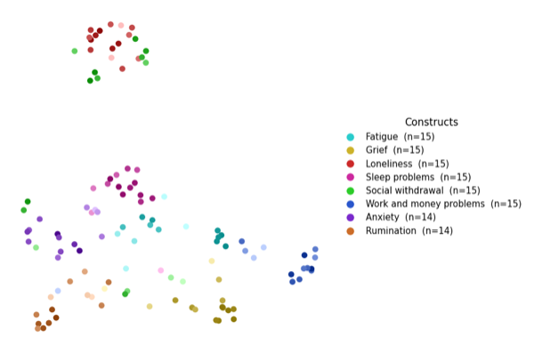

# LLM Tracker

LLM Tracker identifies psychological constructs in text, returns supporting quotes,
and compares LLM coding with human coding. It also includes a discovery workflow
for finding constructs before you have a fixed codebook.

**Beta:** the package is still being tested. Review extracted quotes and validate
performance against human coding for your dataset.

## Tutorials

Start with the main tutorial for coding and comparison, or discovery for building
a codebook. Both setup cells download the package and practice files automatically;
you do not need a local repository before opening them in Colab.

| Tutorial | What it covers | Open in Colab |
| --- | --- | --- |
| [Main tutorial](tutorials/tutorial.ipynb) | Text descriptives, coding, long/wide human data, quote or presence comparison, summary tables, and construct rankings | [](https://colab.research.google.com/github/childmindresearch/llm_tracker/blob/main/tutorials/tutorial.ipynb) |
| [Discovery](tutorials/discovery_tutorial.ipynb) | Discover constructs, merge names, edit/filter groups, reevaluate definitions, export quotes and summaries, and build a codebook | [](https://colab.research.google.com/github/childmindresearch/llm_tracker/blob/main/tutorials/discovery_tutorial.ipynb) |
| [Anonymization](tutorials/anonymization_tutorial.ipynb) | Remove identifying information locally with [anonymize-pii](https://github.com/childmindresearch/anonymize-pii) before sending text to a model | [](https://colab.research.google.com/github/childmindresearch/llm_tracker/blob/main/tutorials/anonymization_tutorial.ipynb) |
| [Embeddings map](tutorials/embeddings_tutorial.ipynb) | Map coded quotes and inspect overlap between constructs | [](https://colab.research.google.com/github/childmindresearch/llm_tracker/blob/main/tutorials/embeddings_tutorial.ipynb) |
| [JEV classification](tutorials/jev_tutorial_v2.ipynb) | Alternative binary and multilabel detection through OpenRouter's alpha Decisions API | [](https://colab.research.google.com/github/childmindresearch/llm_tracker/blob/main/tutorials/jev_tutorial_v2.ipynb) |

The earlier [JEV sentence-to-transcript walkthrough](tutorials/jev_tutorial_v1.ipynb)
is also available ([Open in Colab](https://colab.research.google.com/github/childmindresearch/llm_tracker/blob/main/tutorials/jev_tutorial_v1.ipynb)). Each supplementary tutorial explains its own dependencies and
settings. The main tutorial focuses on ordinary encoding calls; the package's
optional asynchronous batch API is described below.

## What the package supports

- Coding with a defined codebook, including verbatim quotes and recovered character indices.
- Quote-level comparison using an LLM matcher, or document-level presence comparison without another LLM call.
- Long human coding, including Dedoose-style excerpt exports, and wide presence/absence ratings.
- Sensitivity, precision, F1, Jaccard, and PR AUC for quote comparisons; document-level Cohen's kappa, PABAK, and Krippendorff's alpha for presence agreement.
- Separate instance-count agreement metrics, including weighted kappa and ICC, when the data actually records multiple instances per document.
- Editable prompts, floor/ceiling confidence conversion, and ranked document-prevalence tables.
- Timestamped output folders, quote/dataframe exports, saved errors, and a shared run-metadata CSV.
- Optional OpenRouter batch submission, later collection, and explicit retries of failed batch documents.
- Codebook optimization using original quotes or LLM-summarized examples/counterexamples.
- Construct discovery, local grouping edits and filters, and LLM reevaluation of merged names and definitions.

Requests use [Mozilla's any-llm](https://github.com/mozilla-ai/any-llm) for ordinary
LLM calls. OpenRouter is the default provider; `AnalyzerConfig.provider` selects
other supported any-llm providers. Batch coding currently supports OpenRouter only.

## Installation

### Run a notebook

Open the main or discovery Colab link above and run its setup cell. The main
tutorial installs TextDescriptives and an English spaCy model; discovery does not
need those extras. Setup makes no paid LLM calls. Model requests require your own
API key and available provider credits.

### Install locally

For a direct installation, use **Python 3.11 or 3.12**:

```bash
python -m pip install "https://github.com/childmindresearch/llm_tracker/archive/refs/heads/main.zip"
```

This installs the package. To use the bundled practice files locally, download
the repository or run a tutorial's setup cell.

**Python 3.13:** the current package dependency file still requires NumPy >=1.26 and <2,
which prevents a normal installation on Python 3.13. The main and discovery
notebook setup cells apply a compatibility adjustment to their local/downloaded
copy. The main setup also chooses a compatible TextDescriptives version. These
notebook adjustments do not change the repository's dependency file.

For development with Poetry, from a cloned repository and Python 3.11/3.12:

```bash
git clone https://github.com/childmindresearch/llm_tracker.git
cd llm_tracker
poetry install
```

For text-descriptive tutorial extras:

```bash
poetry install --with tutorials
poetry run python -m spacy download en_core_web_sm
```

## API key

Use your own provider key. Never commit a key, a populated `.env` file, or notebook
output displaying credentials. For OpenRouter, set the environment variable:

```bash
export OPENROUTER_API_KEY="your-openrouter-key"
```

In a notebook, enter it privately instead:

```python
import os
from getpass import getpass

os.environ["OPENROUTER_API_KEY"] = getpass("OpenRouter API key: ").strip()
```

`AnalyzerConfig` reads that variable by default. Alternatively, pass an API key
directly or set `api_key="/path/to/.env"` for a file containing
`OPENROUTER_API_KEY=...`. Select a model available to your account; model IDs and
costs are listed at [OpenRouter](https://openrouter.ai/models).

## Inputs and codebooks

| Input | Supported layout |
| --- | --- |
| LLM coding CSV | One document per row, with a text column and optional ID column |
| LLM coding directory | `.txt` and `.csv` files; each file is one document |
| Human coding | Long excerpt rows or wide construct-score columns; CSV, TSV, XLSX, or XLS |
| Discovery | A file or nonrecursive directory of TXT, CSV, XLSX, or XLS files; tabular rows become documents when a text column is supplied |

Excel input needs the appropriate pandas Excel reader. Convert Word documents to
supported text/tabular input before using the coding or discovery loaders.
Document IDs and construct names must match between human coding, LLM results,
and the codebook. Missing coding is not the same as confirmed absence.

Codebooks use a JSON envelope:

```json
{
  "metadata": {"name": "Example", "version": 1, "citation": "", "built_from": []},
  "codebook": {
    "anxiety": {
      "definition": "The speaker describes their own worry, fear, or nervousness.",
      "examples": ["I feel worried about my exams."],
      "counter_examples": []
    }
  }
}
```

Older flat construct dictionaries are also accepted. See the
[practice codebook](sample_data/tutorial_practice/codebook.json) and
[other codebooks](codebooks).

## Basic LLM coding

Replace the model ID, file paths, and column names with your study's values.
Run examples from the repository root when using the bundled practice paths.

```python
from pathlib import Path
from llm_tracker import AnalyzerConfig, LLMTrackerAnalyzer

output_root = Path("research_results")  # Set the parent output folder once.
codebook_path = Path("sample_data/tutorial_practice/codebook.json")
config = AnalyzerConfig(
    model_name="YOUR_OPENROUTER_MODEL_ID",
    master_output_dir=output_root,
    temperature=0,
    max_retries=2,
)
analyzer = LLMTrackerAnalyzer(config=config)

results_llm, metadata_llm, errors_llm = analyzer.analyze_csv(
    csv_path="sample_data/tutorial_practice/documents.csv",
    codebook_path=codebook_path,
    text_column="text",
    id_column="document_id",
)
print("Encoding saved to:", analyzer.output_path)

if errors_llm:
    raise RuntimeError("Review and recover failed coding before comparison.")
```

For directory input, use `analyzer.analyze_directory(input_dir="documents",
codebook_path=codebook_path)` instead. CSV IDs come from `id_column`, or row
numbers when it is `None`; directory IDs come from file stems. Use unique IDs.
Rerunning ordinary encoding processes all supplied documents again.

### Inspect or change the prompt

Do this before encoding:

```python
print(analyzer.prompt)
analyzer.prompt = analyzer.prompt + "\nUse concise quotes that preserve the speaker's wording."
# analyzer.prompt = None  # Restore the default prompt.
```

A complete custom coding template must retain `{text}` and `{codebook}`;
literal JSON braces in templates must be doubled. The quote matcher and discovery
use separate prompts.

## Compare with human coding

Choose the comparison that matches your human data:

| Comparison | Use it for | Additional LLM calls? |
| --- | --- | --- |
| Quote matching | Human-highlighted passages and LLM-extracted quotes | Yes, to match quotes |
| Binary presence | Whether each construct appeared in each document; especially short texts and wide human ratings | No |

### Short texts and wide human ratings

Wide files have one row per document and complete ratings for every codebook
construct, usually `0=absent`, `1=present`. With `construct_suffix="_score"`, a
column named `anxiety_score` becomes the construct `anxiety`.

```python
from llm_tracker.file_handlers import load_human_wide, load_codebook, codebook_constructs
from llm_tracker.presence import compare_presence, rank_constructs_by_percentage
from llm_tracker.comparison import compute_binary_metrics

human_results = load_human_wide(
    "human_wide.csv",
    doc_id_col="document_id",
    text_col="text",
    construct_suffix="_score",
    include_empty=True,
)
codebook = load_codebook(codebook_path)

presence_table = compare_presence(
    human_results=human_results,
    llm_results=results_llm,
    constructs=list(codebook_constructs(codebook)),
    document_ids=list(results_llm),
    master_output_dir=output_root,
    rounding_method="ceiling",
)
binary_summary = compute_binary_metrics(presence_table)
ranked_constructs = rank_constructs_by_percentage(presence_table)
```

Use `include_empty=True` so completed all-zero human rows remain in the comparison.
Each selected document must have completed results on both sides. Explicitly
selecting `document_ids` permits a study subset; do not silently discard missing
or failed documents by taking an intersection.

The grid includes TP (both detected), FP (LLM only), FN (human only), and TN
(neither). `compute_binary_metrics()` adds the saved binary metrics table;
`rank_constructs_by_percentage()` adds the saved ranking. A value such as
**26.2% (28/107)** means the LLM detected the construct in 28 of 107 compared
documents. Multiple quotes in one document count once. This is document prevalence,
not quote share or agreement with humans. Zero-detection constructs are included.

The main tutorial also shows how to rank long-form results using a complete
document-by-construct grid. Do not pass raw quote-match rows to the ranking function.

### Long texts and human-coded passages

Load long human coding and use an LLM matcher to align passages:

```python
from llm_tracker.file_handlers import load_human_coding
from llm_tracker.comparison import (
    LLMTrackerComparer, compute_summary_tables, format_concatenated,
)
from llm_tracker import RunOutput

human_results = load_human_coding(
    "human_coding.csv",
    doc_id_col="Media Title",
    quote_col="Excerpt Copy",
    construct_col="Codes Applied Combined",
    range_col="Excerpt Range",  # None if character positions are unavailable.
    range_format="dash",
    construct_separator=";",
)
missing_ids = sorted(set(results_llm) - set(human_results))
if missing_ids:
    raise ValueError(f"Missing human coding for: {missing_ids}")
human_results = {doc_id: human_results[doc_id] for doc_id in results_llm}

comparer = LLMTrackerComparer(config=config)
comparison_table = comparer.compare_results(
    human_results=human_results,
    llm_results=results_llm,
    output_dir=output_root,
    rounding_method="ceiling",
)
per_doc, pooled, weighted = compute_summary_tables(comparison_table)
formatted = format_concatenated(pooled, min_count=10)

# Numeric summaries save automatically; save the formatted view separately.
run = RunOutput.load(comparison_table.attrs["output_path"])
run.table("metrics_llm_human_quote_matching_formatted", formatted)
```

Use a separator that does not split construct names. Human coding is the reference
for classification metrics. Check that the selected document rosters match before
comparing; the main tutorial performs this check.

`format_concatenated()` now includes two across-construct summaries: an Overall
row with mean (SD) and percentiles, and a second using only constructs with
**TP + FP + FN >= min_count**. The default cutoff is 10. This filters the second
summary only, not the construct rows. These are equally weighted distributions
of construct scores; the raw pooled Overall score answers a different question.
Use `metrics=["f1", "jaccard"]` to show fewer existing metrics. It does not add
new calculations. The short-form binary summary has one pooled Overall row.

### Confidence conversion

The default coding prompt uses `1` for indirect/unclear evidence and `2` for clear
evidence. Select one policy for comparison:

- `rounding_method="floor"` (the function default): `0/1 -> 0`, `2 -> 1`.
- `rounding_method="ceiling"`: `0 -> 0`, `1/2 -> 1`.

Long-form matching drops zero-scored LLM instances before matching. Short-form
comparison keeps the document/construct rows as absences. Human ratings and the
original encoding results are unchanged. For LLM outputs that are already binary,
use `binarize_confidence=False`; this setting does not refer to the human 0/1 data.

### Quote index recovery

Quote positions are recovered exactly by default. Set
`AnalyzerConfig(fuzzy_quote_matching=True, ...)` to allow fuzzy position recovery
when extracted quotes differ slightly from the source. This is separate from the
LLM quote matcher and from discovery's fuzzy construct-name matching.

## Output folders and metadata

Set `AnalyzerConfig(master_output_dir=output_root)` for coding, matching, and
optimization. Standalone presence comparison accepts `master_output_dir` too.
Dataframes retain their run directory in `attrs["output_path"]`, so downstream
metrics and ranking functions can reuse the directory without typing timestamps.

| Under the output root | Contents |
| --- | --- |
| `run_metadata.csv` | One row per tracked run, including settings, paths, status, counts, and available API usage/cost metadata; inapplicable fields are `N/A` |
| `llm_encodings_<model>_<timestamp>/` | `encodings/`, `metadata/`, `errors/`, and a quote dataframe CSV in `DF/`; batch runs also contain frozen inputs and job records in `batch/` |
| `comparison_short_<model>_<timestamp>/` | Presence grid, both quote views, binary metrics, and any requested ranking/review tables |
| `comparison_long_<model>_<timestamp>/` | Quote matches, document/pooled/weighted metrics, quote views, and any additional saved tables |
| `codebook_optimization_<model>_<timestamp>/` | Partial optimized codebooks and optimization metadata; reruns receive linked run records |
| `text_descriptives_...csv` | Corpus summary and per-document measurements, saved directly under the root when requested |

Generated comparison CSV names include the model and timestamp. The short-form
workflow writes:

- `llm_human_presence_grid_<model>_<timestamp>.csv`
- `llm_quotes_by_doc_index_score_<model>_<timestamp>.csv`
- `llm_quotes_by_construct_<model>_<timestamp>.csv`
- `metrics_llm_human_binary_<model>_<timestamp>.csv` when binary metrics are computed
- `llm_construct_presence_ranked_<model>_<timestamp>.csv` when ranking is requested

The indexed quote export retains original confidence and adds the confidence used
for comparison. Run directories also contain `run_metadata.json`; prompts and
codebooks are saved separately from the CSV register. API keys are excluded from
run metadata. Discovery currently saves its own timestamped files through
`output_dir`; it does not append discovery steps to the master run register.

## Batch processing: submit now, collect later

This is an alternative to ordinary encoding, not an additional required step.
Choose an OpenRouter model with batch support. Submission returns before the
model has finished:

```python
job = analyzer.submit_batch_csv(
    csv_path="documents.csv",
    codebook_path=codebook_path,
    text_column="text",
    id_column="document_id",
    batch_size=1000,
)
batch_run_dir = job.output_path
print("Keep this run path:", batch_run_dir)
```

For directory input, use `submit_batch_directory()`. Batch size limits documents
per job; documents are still separate requests. To check and collect the same run
later, including after reopening Python:

```python
print(analyzer.batch_status(batch_run_dir))
results_llm, metadata_llm, errors_llm = analyzer.collect_batch(batch_run_dir)
```

If jobs are still pending, collection raises `BatchNotReadyError`; wait and rerun
status/collection, not submission. Completed successful results are cached locally.
If a finished batch contains failed documents, explicitly retry only those:

```python
job = analyzer.retry_batch_errors(batch_run_dir)
```

Then check and collect again. Successful documents are reused. `max_retries`
controls ordinary requests/parsing, not automatic batch resubmission. Batch mode
does not silently fall back to ordinary requests. Quote matching remains ordinary
LLM calls; presence comparison and metrics do not need batching.

For synchronous **directory** runs, `analyzer.retry_errors(output_dir=analyzer.output_path,
codebook_path=codebook_path)` returns recovered documents, metadata, and remaining
errors. Merge recovered dictionaries into the results you retained. Use
`retry_batch_errors()` for batch runs, including batch CSV inputs.

## Codebook optimization

`optimize_codebook()` uses quote-level comparison rows and the numeric pooled
summary. It is not a presence-grid optimizer. It supports CSV inputs and directories,
and `llm_output_dir` controls the output parent for optional encoding reruns.

With `summarize_examples=True`, all relevant false-negative and false-positive
quotes contribute to short LLM-generated examples/counterexamples. `n_examples`
and `n_counterexamples` cap additions; they never exceed the source counts.
The default `False` preserves sampling of original quotes. Summarization makes
LLM calls. `rerun_optimized_codebook=0` saves one partial revision without recoding;
positive values start additional paid coding/comparison passes. Review revisions
before merging them into the full codebook.

## Discovery

The notebook is called `discovery_tutorial.ipynb`; the current Python module is
**`llm_tracker.discovery_v2`**. Discovery accepts a framework rather than a fixed
construct list:

```python
from llm_tracker.discovery_v2 import (
    LLMTrackerDiscoverer, merge_constructs, build_discovery_tables, build_codebook,
)

discoverer = LLMTrackerDiscoverer(config=config)
discoveries, discovery_metadata, discovery_errors = discoverer.discover(
    path="documents.csv",
    framework="Cognitive behavioral therapy",
    text_column="text",
    id_column="document_id",
    output_dir=output_root / "discovery",
    save_format="both",
)
if discovery_errors:
    raise RuntimeError("Review discovery errors before interpreting the results.")

merged, discovery_merge_table = merge_constructs(
    discoveries, config=config, framework="Cognitive behavioral therapy",
    output_dir=output_root / "discovery",
)
all_quotes, construct_summary = build_discovery_tables(
    discoveries, discovery_merge_table,
    output_dir=output_root / "discovery",
)
discovered_codebook = build_codebook(
    merged, name="Discovered codebook", n_examples=3,
    output_path=output_root / "discovery" / "codebook.json",
)
```

The pipeline normalizes constituent names, supports conservative fuzzy spelling
matching, and keeps lowercase constituents separate from LLM-defined merged groups.
`apply_merge_edits()` applies a grouping dictionary; `filter_merged_constructs()`
removes named or low-count/low-prototypicality members. These steps are local.
`reevaluate_merged_constructs()` asks the LLM to reconsider names and definitions
after edits, using the previous groups and removed members.

The all-quotes export retains every original quote occurrence and flags removed
constituents. The construct summary covers retained merged groups, with definitions,
constituent/document/instance percentages, prototypicality mean (SD), all unique
example texts, and constituent lists. Original denominators stay fixed after
filtering. The review display's three-quote limit does not discard quotes; codebook
example sampling is a separate setting. See the discovery tutorial for details.

## Embeddings and visualization

The [embeddings tutorial](tutorials/embeddings_tutorial.ipynb) reads a coding table
such as `format_coding_table(results_llm)`, maps quotes into two dimensions, and
produces overlap/review tables. It explains its optional dependencies.



*Example data: prototypical phrases from the Suicide Risk Lexicon (8 non-suicidal constructs).*

## Testing

From a development checkout:

```bash
poetry run pytest
```

Tests use mocked API calls to check package behavior, file handling, comparison,
configuration, and parsing.

## Data privacy

Coding, discovery, summarization, and quote matching send text to the selected
provider. Presence comparison, metrics, grouping edits, and filtering run locally.
Use only approved data and check your institution's requirements and the provider's
data-handling policy. Saved quotes, prompts, codebooks, and outputs may contain
sensitive research text even though API keys are excluded from metadata.

Before sending identifying text to a model, see the
[anonymization tutorial](tutorials/anonymization_tutorial.ipynb). Automated
anonymization still needs human review.

## Citation and funding

Please cite this if you use the package:

Low, D., Mair, P., Nock, M., & Ghosh, S. (in press). Text Psychometrics: Assessing
Psychological Constructs in Text Using Natural Language Processing. PLOS Digital Health.

Preprint: <https://osf.io/preprints/psyarxiv/9rdux_v5>

Funded by the Mind and Life Institute Varela Grant.
